# Facial Emotion Recognition Pipeline

End-to-end system for detecting emotions in facial images using pretrained and custom-trained deep learning models, with an interactive dashboard and ensemble inference.

## Team and Acknowledgements

Developed at **HSLU** as part of the **Data Science Project** course.

Members: Marco Blum, Kim Bortis, Lukas Pfruender, Corsin Hidber

## Getting Started

```bash
git clone <https://github.com/CorsinAI/Data-Science-Project>
cd <Data-Science-Project>
python -m venv venv
source venv/bin/activate  # Windows: venv\Scripts\activate
```

**Just want to run the dashboard?** Use the lightweight requirements (CPU-only PyTorch, ~200 MB):

```bash
pip install -r requirements-ui.txt
streamlit run src/visualization/app.py
```

**Need GPU training as well?** Use the full requirements (includes CUDA 12.4, ~2.5 GB):

```bash
pip install -r requirements.txt
```

Python 3.12 is recommended. If your system uses a different CUDA version, install PyTorch separately following [pytorch.org](https://pytorch.org/get-started/locally/) before running `pip install -r requirements.txt`.

## What the Dashboard Can Do

The Streamlit dashboard provides four modes for exploring emotion recognition across three models (DeepFace, FER, and our Custom-ResNet18) side by side.

### Batch Analysis

Run all three models across an entire dataset split at once. The dashboard shows per-model accuracy, agreement statistics, and a breakdown of where the models disagree. This is how we evaluated model performance across thousands of images without writing one-off scripts.

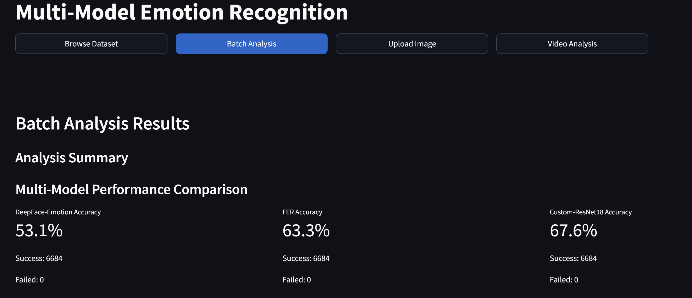

The per-emotion accuracy view reveals where each model struggles. All three models handle *happy* and *surprised* well but consistently underperform on *disgusted* and *fearful*. This is due to class imbalance in the training data.

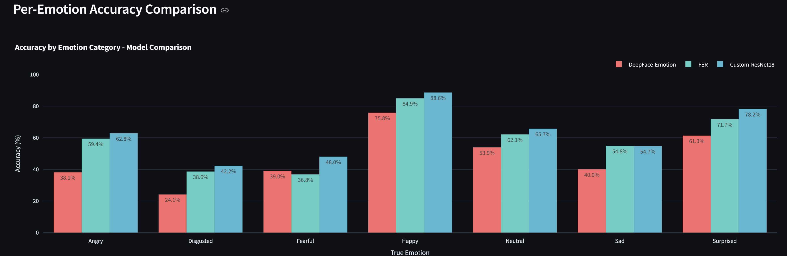

### Single Image Analysis

Pick any image from the dataset or upload your own. The dashboard displays each model's prediction with confidence scores, a grouped bar chart comparing probability distributions across all seven emotions, and color-coded result cards showing agreement or disagreement.

When all three models agree with high confidence, the prediction is almost always correct:

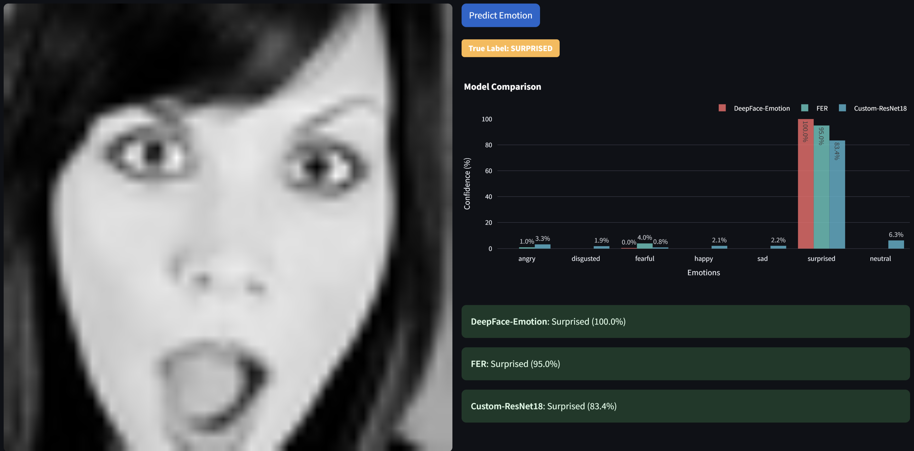

When models disagree, it usually indicates a genuinely ambiguous expression. Here, DeepFace predicts *neutral* while FER predicts *sad* -- the true label is *sad*, and the image is arguably ambiguous:

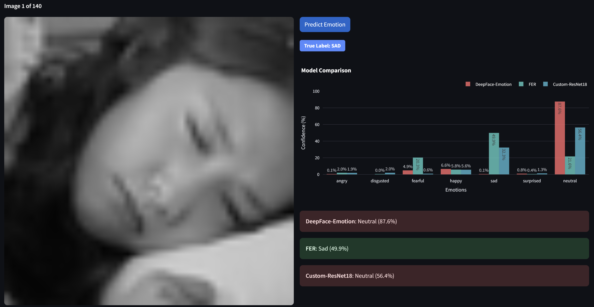

The hardest class is *disgusted*, where even strong predictions can split between models. Below, FER and Custom-ResNet18 both correctly predict *disgusted*, but DeepFace sees *fearful*:

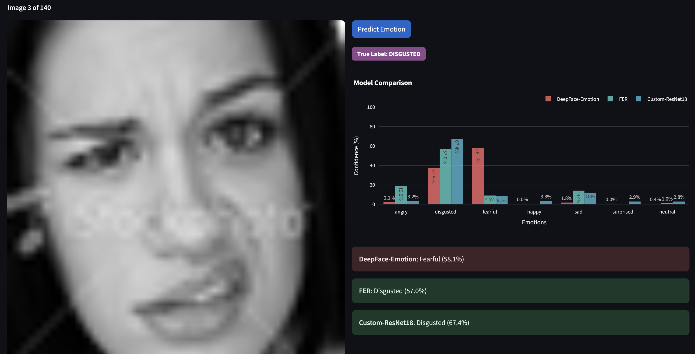

### Video Analysis

Upload a video and the dashboard processes it frame-by-frame with configurable frame skip. It detects faces, runs all selected models, and produces an emotion timeline showing how predictions shift across the video. Useful for analyzing temporal consistency of predictions.

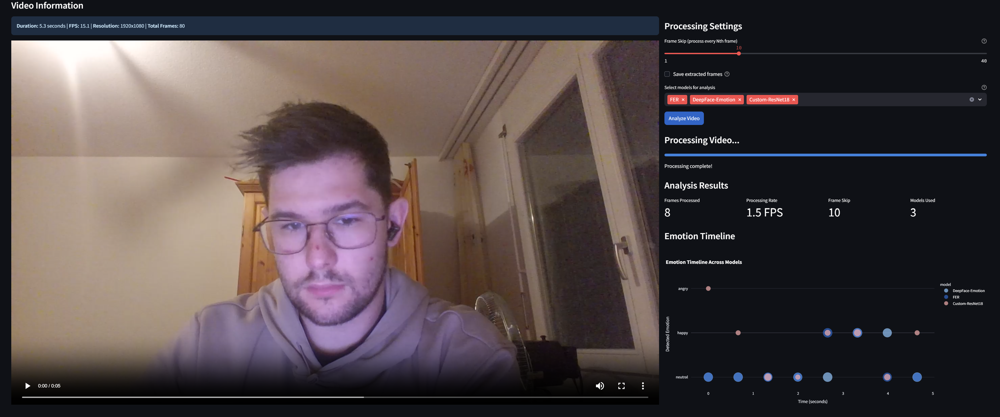

### Browse Dataset

Navigate training and test images by emotion class. Useful for visually inspecting data quality and class distribution before any modeling.

---
## Project Structure

```
.
├── src/
│   ├── emotion_detection/
│   │   └── detector.py            # EmotionDetector class (inference API)
│   ├── data_processing/           # Data quality assessment scripts
│   └── visualization/
│       └── app.py                 # Streamlit dashboard
├── models/
│   └── private_model.py           # ResNet18 training script
├── experiments/
│   ├── configs/                   # 12 YAML experiment configurations
│   ├── runs/                      # Experiment outputs (weights, metrics)
│   ├── results_figures/           # Generated plots and tables
│   ├── run_experiment.py          # Single experiment runner
│   ├── run_batch.py               # Batch experiment runner
│   └── visualize_*.py             # Visualization scripts
├── runs/
│   └── exp2_clean/                # Best trained model checkpoint
├── results/                       # Evaluation reports (ensemble, per-dataset)
├── examples/                      # Example and evaluation scripts
├── docs/                          # Additional documentation and images
├── data/                          # Datasets (not tracked in git)
│   ├── raw/
│   └── processed/
├── requirements.txt               # Full dependencies (GPU training)
├── requirements-ui.txt            # Lightweight dependencies (dashboard only)
└── .gitignore
```

---

## Technical Details

### Background

Recognizing human emotions from facial expressions is a long-standing challenge in computer vision. Early benchmark datasets like FER2013 established the 7-class taxonomy (angry, disgusted, fearful, happy, neutral, sad, surprised) that most research still follows, while larger-scale collections such as AffectNet and RAF-DB pushed state-of-the-art accuracies into the low-to-mid 60s on in-the-wild images. On the tooling side, open-source libraries (notably [DeepFace](https://github.com/serengil/deepface) and [FER](https://github.com/justinshenk/fer)) have made pretrained emotion classifiers accessible to anyone with a `pip install`.

### Our Approach

We compared three detection strategies, ranging from fully pretrained to custom-trained:

**DeepFace-Emotion** is the emotion analysis backend from the [DeepFace](https://github.com/serengil/deepface) library. It ships a pretrained CNN and requires no training on our side. Out of the box it reached 53% accuracy on the Faces Dataset test set -- useful as a baseline but clearly limited.

**FER** (the [Facial Expression Recognition](https://github.com/justinshenk/fer) library) provides another pretrained CNN. It performed noticeably better at 63%, likely because its training data overlaps more closely with the kinds of images in our test set.

**Custom-ResNet18** is where we spent most of our effort. We took a ResNet18 backbone pretrained on ImageNet and replaced the final fully-connected layer with a custom classification head for 7 emotions. ResNet18 was chosen deliberately over larger architectures: it trains in reasonable time on a consumer GPU (8 GB VRAM) while still providing enough representational capacity for this task. We used AdamW with OneCycleLR scheduling, cross-entropy with label smoothing (0.1), dropout (0.3), weight decay (0.05), and MixUp augmentation. This model reached 67.59% accuracy, and our best checkpoint (`runs/exp2_clean/`) scored 68.05% with a macro F1 of 65.30%.


### Datasets

Download the datasets and place them under `data/raw/` matching this structure:

```
data/raw/
  Faces_Dataset/
    train/{angry,disgusted,fearful,happy,neutral,sad,surprised}/
    test/{angry,disgusted,fearful,happy,neutral,sad,surprised}/
  emotion dataset 3/
    DATASET/train/ and DATASET/test/
    train_labels.csv and test_labels.csv
```

| Dataset | Size | Format | Notes |
|---------|------|--------|-------|
| Faces Dataset (primary) | 35,887 images (28,709 train / 7,178 test) | PNG, 7 emotion folders per split | [TODO: source link] |
| Emotion Dataset 3 | 15,339 images (12,271 train / 3,068 test) | 48x48 aligned JPEG + CSV labels | `happy` 38.8%, `disgusted` 2.3%. [TODO: source link] |
| Faces Dataset 2 (supplementary) | 172 high-quality images | Includes demographic metadata (gender, age, country) | Quality benchmarking and bias analysis |

### Experiments and Lessons Learned

We ran a systematic hyperparameter search across 12 configurations, varying learning rate, batch size, epoch count, loss function, augmentation strategy, and class balancing method. Full details are in [`experiments/EXPERIMENTS_SUMMARY.md`](experiments/EXPERIMENTS_SUMMARY.md).

#### Training Setup

| Parameter | Value |
|-----------|-------|
| Architecture | ResNet18 (pretrained on ImageNet) |
| Image size | 224x224 |
| Optimizer | AdamW |
| Learning rate | 3e-4 (baseline) |
| Batch size | 128 |
| Epochs | 30 (baseline) |
| Weight decay | 0.05 |
| Label smoothing | 0.1 |
| Hardware | Local GPU with 8 GB VRAM |
| Seed | 42 |

#### What We Tried and What We Learned

**Heavy augmentation helped the most.** The `aug_heavy` configuration (aggressive random crops, color jitter, horizontal flips) produced the best single result at 68.36% accuracy / 65.52% macro F1. This was consistently above the baseline across runs, suggesting the model was mildly overfitting with standard augmentation.

**Focal loss was a net positive for minority classes.** Switching from cross-entropy to focal loss (`loss_focal`) improved F1 on underrepresented emotions like *disgusted* and *fearful*, pushing overall macro F1 to 65.13%. However, it slightly hurt accuracy on majority classes, so the accuracy gain was modest (67.61% vs. 66.85% baseline).

**Class imbalance remained our biggest headache.** `disgusted` accounts for only 2.3% of Dataset 3. We tried inverse-log class weighting and weighted random sampling (`balance_weighted_sampler`); both helped recall on rare classes but introduced instability in training loss. No single strategy fully resolved the imbalance.

**Longer training showed diminishing returns.** Extending from 30 to 50 epochs (`epochs_50_extended`) gave 67.35% -- barely above baseline.

**Smaller batches were slightly better.** Batch size 64 (`batch_64_smaller`) reached 67.46% / 65.00% F1, outperforming batch size 256 (`batch_256_larger`). The smaller batch likely provides a regularization effect through noisier gradient estimates.


#### Reproducing the Experiments

```bash
# Single experiment (baseline)
python experiments/run_experiment.py experiments/configs/baseline.yaml \
    --data_root data/raw/Faces_Dataset

# All 12 experiments
python experiments/run_batch.py --data_root data/raw/Faces_Dataset
```

Outputs (weights, metrics, confusion matrices) are saved under `experiments/runs/<experiment_name>/`.

#### Evaluation Scripts

```bash
# Evaluate all three models on Faces Dataset
python examples/ensemble_faces_dataset.py

# Evaluate on Emotion Dataset 3
python examples/evaluate_models_dataset3.py

# Compare original vs. grayscale
python examples/compare_original_vs_greyscale.py
```

### Results

#### Model Comparison on Faces Dataset Test Set

| Model | Accuracy | Macro Precision | Macro Recall | Macro F1 |
|-------|----------|-----------------|--------------|----------|
| DeepFace-Emotion | 53.13% | 51.57% | 47.46% | 48.76% |
| FER | 63.33% | 60.36% | 58.33% | 58.95% |
| Custom-ResNet18 | 67.59% | 66.29% | 62.87% | 63.97% |
| Ensemble | 67.85% | 67.54% | 62.40% | 63.86% |

#### Best Custom-ResNet18 Checkpoint (`runs/exp2_clean/`)

- **Test accuracy**: 68.05%
- **Test macro F1**: 65.30%

#### Hyperparameter Tuning Highlights

| Experiment | Test Accuracy | Test Macro F1 |
|------------|--------------|---------------|
| baseline_resnet18 | 66.85% | 63.68% |
| aug_heavy | 68.36% | 65.52% |
| loss_focal | 67.61% | 65.13% |
| lr_high_1e3 | 67.07% | 63.93% |
| epochs_50_extended | 67.35% | 64.58% |
| batch_64_smaller | 67.46% | 65.00% |

All metrics are taken directly from experiment logs and evaluation reports in the repository.

### Analysis

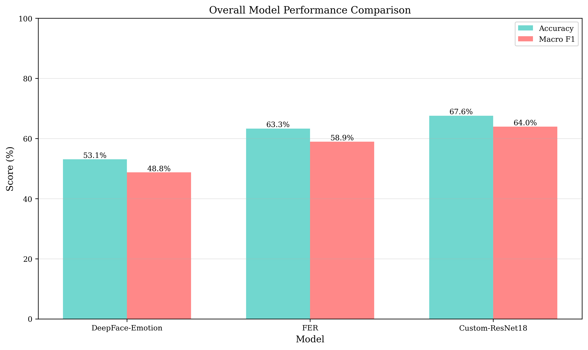

F1 scores broken down by emotion and model. *Happy* is easy for everyone; *disgusted* and *fearful* remain the hardest classes across all three models:

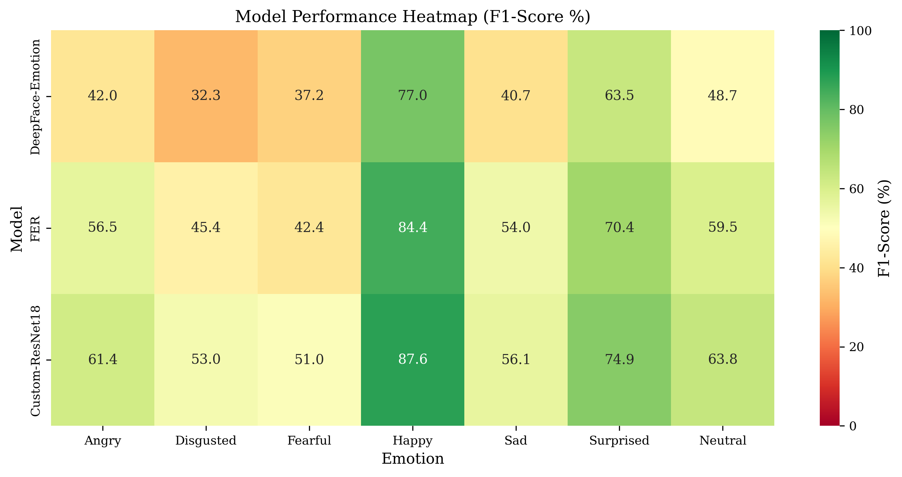

Side-by-side precision, recall, and F1 per emotion for each model.

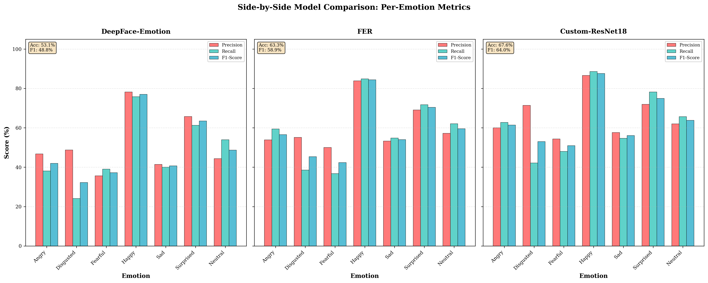

Confusion matrix for Custom-ResNet18. The dominant misclassification pattern is *fearful* being predicted as *sad*.

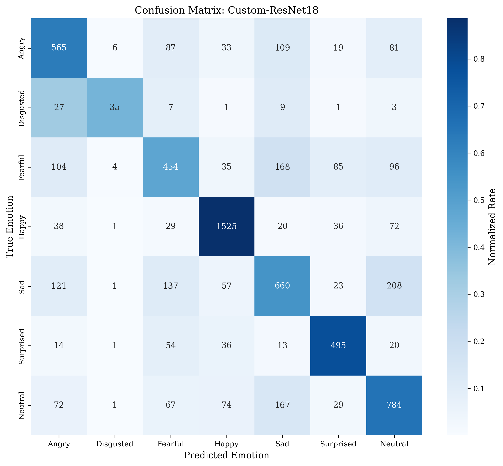

Model agreement analysis. All three models agree on only 46.1% of images overall, but when they do agree, accuracy jumps to 85%+ for most emotions. The exception is *disgusted* and *fearful*, where even unanimous agreement yields below 60% accuracy:

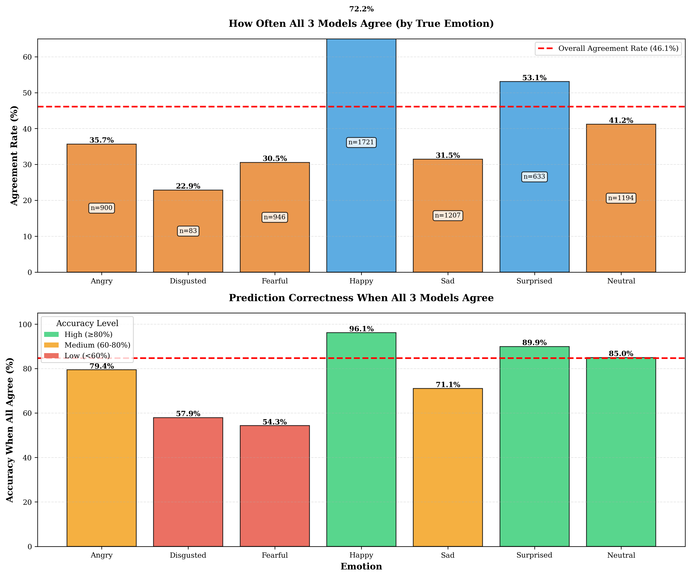

Hyperparameter experiment comparison across all 12 configurations. Heavy augmentation ranks first; the differences between most other configurations are narrow:

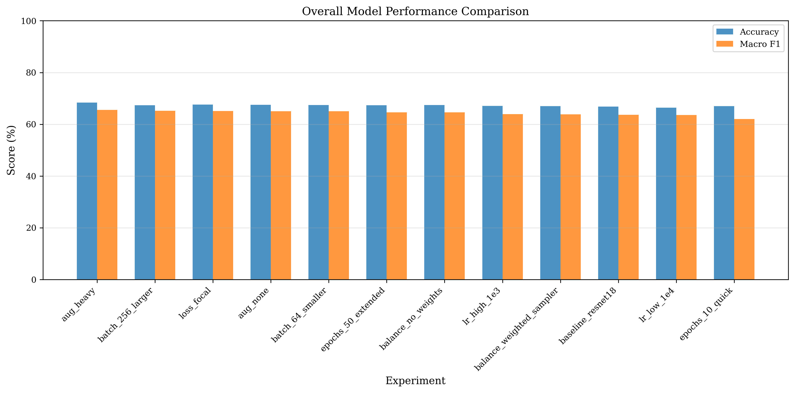

Per-emotion F1 scores across all 12 experiment configurations. *Happy* is robust to hyperparameter changes; *disgusted* shows the most variance, with `epochs_10_quick` performing worst (0.438) and `batch_256_larger` best (0.642):

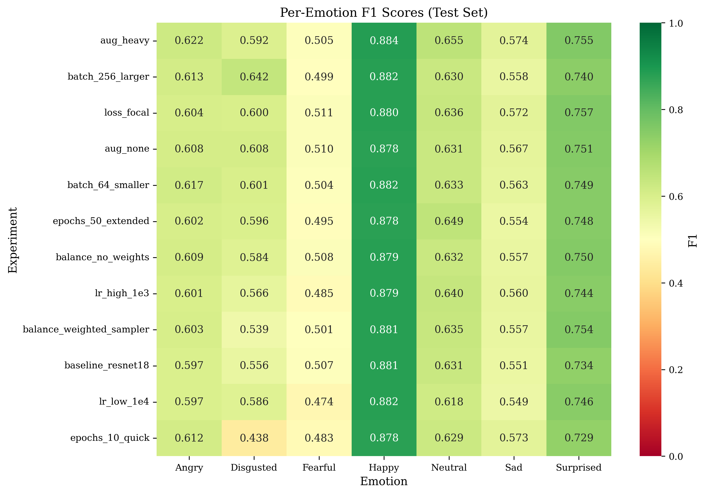

## Limitations

- **Class imbalance**: `disgusted` has very few samples (2.3% of Dataset 3), and all models perform worst on this class. Focal loss and weighted sampling provided marginal improvements.
- **Ensemble overhead vs. gain**: The override ensemble adds complexity but yields only +0.25% accuracy on the Faces Dataset. A learned combination or stacking approach could be more effective.
- **Dataset bias**: Models were trained on aligned, cropped faces. Performance degrades on in-the-wild images where face detection must first succeed.
- **Grayscale vs. color**: Comparison experiments are included; pretrained models (DeepFace, FER) were designed for specific input formats, limiting direct comparison.